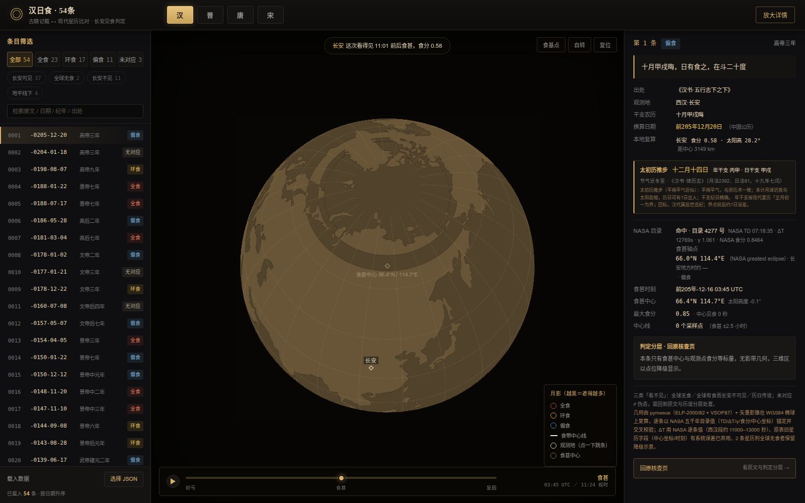

# CalcEclipses · 历代日食：古籍记载与星历复算比对

一个纯前端的**历史科普**可视化项目：把中国正史里的日食记载，与现代天体力学的
星历复算并排放在同一张三维地球上对照观看。无需安装、无需打包——浏览器打开即用。

朝代清单由配置驱动（`js/registry.js` + `data/*.js`），顶栏按钮按年代排序，
详情、筛选、时间轴随之切换，**新增朝代无需改动界面代码**。目前已收录：
**汉（《汉书·五行志》54 条）、晋（《晋书·天文志》60 条）、唐（《新唐书·天文志》93 条）、
宋（《宋史·天文志》等 225 条）**；后续将按同一管线陆续补充其它朝代。



---

## ⚠️ 科普非专业声明（请先读）

本项目定位是**面向大众的历史科普与可视化演示**，不是专业天文、历法或史学研究工具：

- **几何为现代近似复算**：星历由 pymeeus（ELP-2000/82 + VSOP87）计算，与 NASA
  目录逐条校验后仍有**食分偏差 ≤0.05、影心偏差中位 <150 km、食甚时刻 ≤7 分钟**的
  固有精度边界；古代 ΔT（地球自转修正）为模型值，越早期不确定性越大。
- **古籍原文逐字照录、不预设其误**：史书日食很多出自历官推步而非实测，存在虚报与
  传抄讹误；本项目将「原文」与「复算」分行呈现、矛盾如实标注，**不给真伪定论**。
- **历法推步卡是近似参照列**：按各朝当期历法常数平朔平气推算，与历史实际历日可有
  1 日出入，仅供科普对照。
- **不得**将本项目数据或结论用于学术引用、论文考证、工程、航天或任何专业用途；
  专业需求请直接查阅 NASA 官方目录、正史底本与相关领域文献。

## 功能亮点

- **三维影带**：本影带、中心线、逐时刻月影在 WGS84 椭球上严格复算渲染；
  可沿时间轴逐帧回放一次日食的全过程。
- **判定分层**：每条目分「原文层 → 历日层 → 星历层 → 可见层 → 结论层」呈现，
  点「放大详评」可见方法论与统计。
- **当期历法推步卡**：按各朝当期历法常数（如太初历、泰始历、大衍历、纪元历）
  平朔平气推算，干支纪日精确、农历月日近似。
- **如实降级**：目录判无食、古籍「当食不食」「云阴不见」等条目照录并标注，不补食、
  不编几何。

## 快速开始

### 方式一：一键启动（推荐）

```bash
git clone https://github.com/<你的用户名>/CalcEclipses.git
cd CalcEclipses
./run.sh          # Linux / macOS
```

Windows：克隆后直接**双击 `run.bat`**（或在命令行运行 `run.bat`）。

脚本会自动完成：检查并获取本地 Cesium（首次约 20MB，需 npm）→ 起本地静态服务 →
自动打开浏览器。停止：Ctrl+C（Windows 关闭窗口）。若端口 8123 被占用，Linux/macOS
会自动换空闲端口；Windows 请改 `run.bat` 里的 `8123`。

### 方式二：手动三步

```bash
# 1. 获取本地 Cesium（一次性；详见 tools/fetch_cesium.sh）
bash tools/fetch_cesium.sh

# 2. 起任意静态服务器，在项目根目录
python3 -m http.server 8123

# 3. 浏览器打开 http://localhost:8123
```

> Cesium 不入 git 仓库（体积原因），必须先执行第 1 步；缺失时页面会显示错误面板。
> 项目**不回退 CDN**——Cesium Workers 的动态导入在 CDN 下会失败导致渲染停止。

## 目录结构

```
CalcEclipses/
├─ index.html                 统一入口；数据脚本区按年代序引入 data/*.js
├─ run.sh / run.bat           一键启动（自动取 Cesium + 本地服务 + 开浏览器）
├─ css/app.css                全局样式（暗底古铜）
├─ js/                        registry（朝代配置）/ calendar（历法推步）/
│                             renderers（详情渲染）/ app（Cesium 引擎与时间轴）
├─ data/                      各朝数据（生成物，含逐条目录锚定与几何），_template.js 为字段规范
├─ lib/cesium/                Cesium 1.120 本地构建产物（不入库，fetch_cesium.sh 生成）
├─ tools/                     数据管线：pymeeus 星历 + 矢量影锥 + NASA 目录锚定 + 质量门
└─ docs/DEVELOPMENT.md        开发规范：数据管线铁律、前端规范、新增朝代步骤、验证方式
```

## 数据与方法（简述）

- **星历层**：pymeeus（ELP-2000/82 全项 + VSOP87）+ 矢量影锥在 WGS84 椭球上复算，
  逐条以 NASA 五千年日食目录（5MKSE）锚定并交叉校验。
- **历日层**：原文干支朔晦照录为权威；晋以干支独立定日，宋补入条目用「原记朔日
  锚点链插值」补农历月序；目录 ±1 日内无食者如实降级。
- **可见层**：按条目观测地（长安/洛阳/建康/开封/临安/开城）单独判定可见性与
  太阳高度，「全球有食」与「本地见食」分开呈现。
- 更完整的管线铁律、精度边界与开发者规范见 **[docs/DEVELOPMENT.md](docs/DEVELOPMENT.md)**。

## 数据来源与致谢

- [NASA Five Millennium Canon of Solar Eclipses（Espenak & Meeus）](https://eclipse.gsfc.nasa.gov/5MCSE/5MCSE-index.html) —— 目录锚定基准
- 《汉书·五行志》《晋书·天文志》《新唐书·天文志》《宋史·天文志》等正史底本（中华书局点校本）
- [pymeeus](https://github.com/shewbit/pymeeus)（Astronomical Algorithms 的 Python 实现）—— 星历计算
- [CesiumJS](https://cesium.com/) —— 三维地球引擎（Apache-2.0）

## 许可证

本项目代码与生成数据以 [MIT License](LICENSE) 发布。
第三方组件遵循其各自许可：CesiumJS（Apache-2.0）、pymeeus（LGPL-3.0，仅在本项目
tools/ 生成管线中作为独立 Python 库调用，不随前端分发；仓库内 data/ 为其生成产物）、
NASA 五千年目录（美国政府部门作品，公有领域）。
